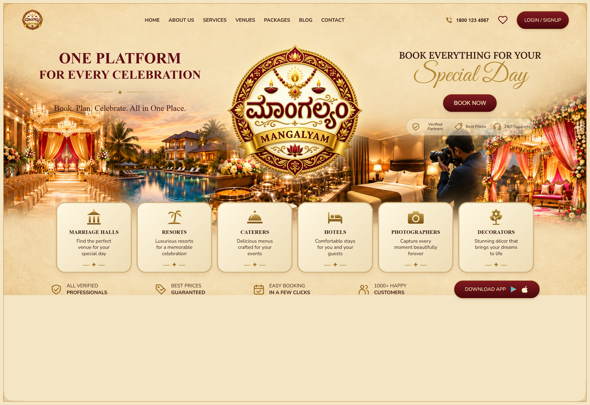
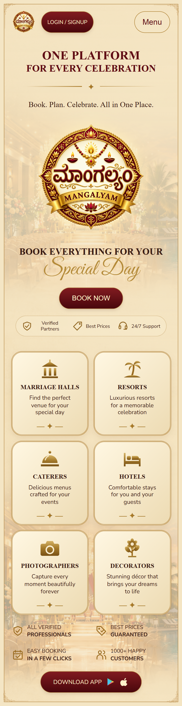

# Mangalyam — Celebration Services Landing Page

A responsive React landing page recreated from the supplied design reference for a frontend development assignment.

The implementation focuses on visual similarity, responsive layouts, reusable components, and readable code.

## Features

- Wedding-themed design with cream, gold, and burgundy colours.
- Hero section with blended background imagery and prominent branding.
- Six service categories: marriage halls, resorts, caterers, hotels, photographers, and decorators.
- Responsive service grid with six columns on desktop, three on tablet, and two on mobile.
- Collapsible mobile navigation.
- SVG service icons and trust badges.
- Demo dialogs for login, favourites, and app downloads.
- Keyboard focus styles and reduced-motion support.

## Technologies

- React
- JavaScript
- Vite
- CSS with Grid, Flexbox, custom properties, and media queries
- Inline SVG
- ESLint
- Google Fonts

## Getting Started

Install Node.js and npm, using a Node.js version compatible with the Vite version in `package.json`.

Clone the repository:

```bash
git clone https://github.com/Monikarana27/mangalyam.git
cd mangalyam
```

Install dependencies from the lockfile:

```bash
npm ci
```

Start the development server:

```bash
npm run dev
```

Open the local URL printed in the terminal.

## Available Commands

| Command | Purpose |
| --- | --- |
| `npm run dev` | Start the development server |
| `npm run lint` | Check the code with ESLint |
| `npm run build` | Generate the production build in `dist` |
| `npm run preview` | Preview the production build locally |

## Project Organisation

- `src/components/` — reusable UI components, including the header, hero, service cards, icons, footer, and dialogs.
- `src/data/services.js` — service titles, descriptions, and icon identifiers.
- `src/App.jsx` — page composition.
- `src/App.css` — component styling and responsive layouts.
- `src/index.css` — global styles and resets.
- `public/images/` — background artwork, logo, and decorative images.
- `screenshots/` — desktop and mobile screenshots.

## Design Approach

The supplied reference guided the page composition, colour palette, typography, card styling, and decorative details.

The desktop hero uses a three-column layout. On smaller screens, the content stacks vertically, navigation collapses into a menu, and the service grid reduces its column count.

Serif headings preserve the reference's traditional style, while sans-serif body text improves readability. A script font highlights “Special Day”.

Background imagery is combined with translucent cream overlays to keep text readable on smaller screens. Text and interactive controls remain HTML elements rather than being embedded in a screenshot.

Service content is stored separately from presentation components so categories can be updated without duplicating markup. Shared CSS variables help keep colours and typography consistent.

## Assets and Assumptions

- The reference was supplied as an image rather than an editable design file.
- Background artwork, the logo, and decorative imagery were recreated with AI image-generation assistance.
- Typography and illustrations are approximations of the reference; this is not a pixel-perfect reproduction using original source assets.
- The mobile layout was adapted from the desktop reference.
- Google Fonts requires an internet connection; fallback fonts are provided.

## Scope and Limitations

This is a frontend UI demonstration.

- Login and favourites open informational dialogs; authentication and saved favourites are not implemented.
- Download App opens an informational dialog because app-store URLs were not supplied.
- Book Now links to the services section; there is no booking or payment flow.
- Navigation items without dedicated pages use placeholder in-page destinations.
- Service cards link to the footer contact anchor.
- The phone number and promotional claims are demonstration content from the design.
- No backend, database, or external API is connected.

## Validation

- `npm run lint` completed successfully.
- `npm run build` completed successfully.
- Desktop and 375px mobile layouts were visually reviewed in Chrome.
- The production build was previewed locally with `npm run preview`.

## Screenshots

### Desktop



### Mobile



## Potential Improvements

- Replace recreated artwork with original brand assets.
- Optimise large images and provide responsive image variants.
- Connect navigation to dedicated pages.
- Implement booking, authentication, and saved favourites.
- Add real app-store destinations.
- Extend testing across browsers and physical devices.
